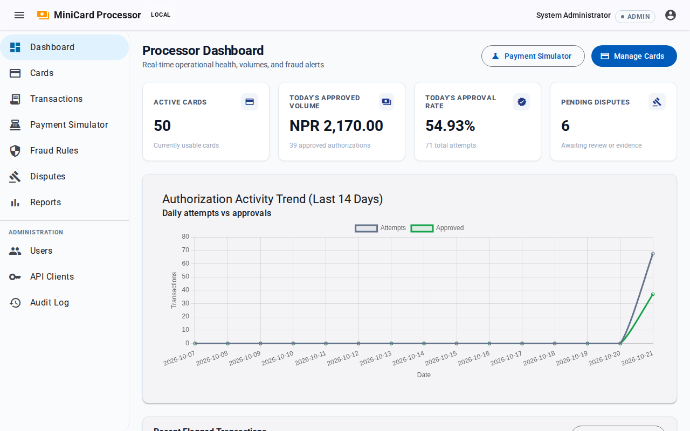
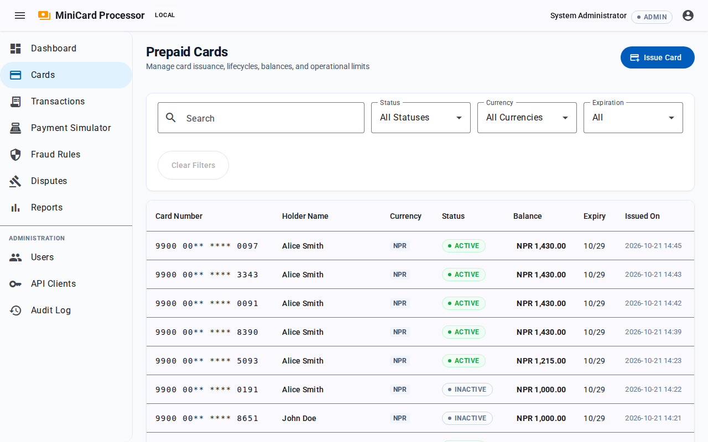
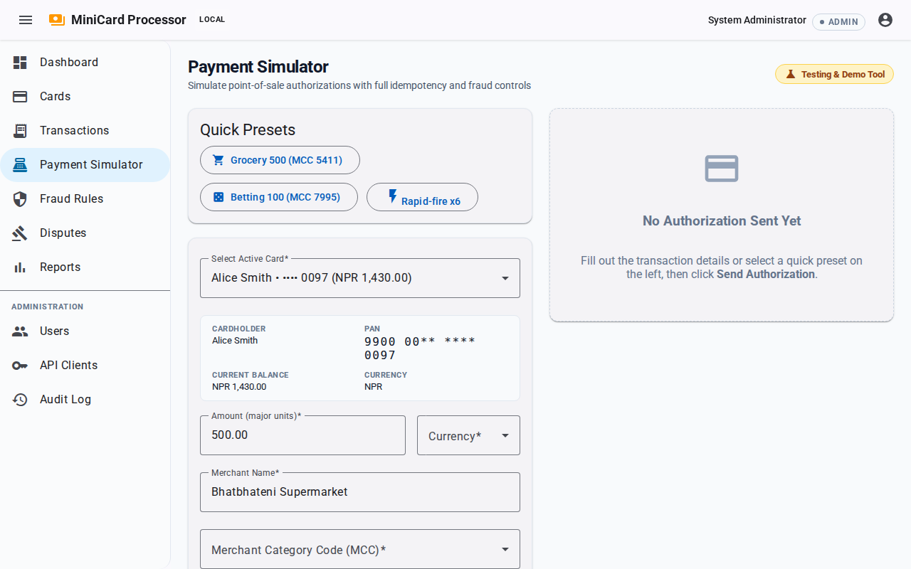
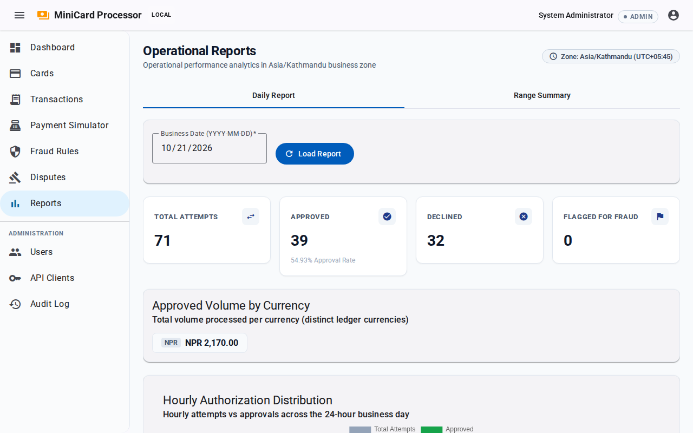
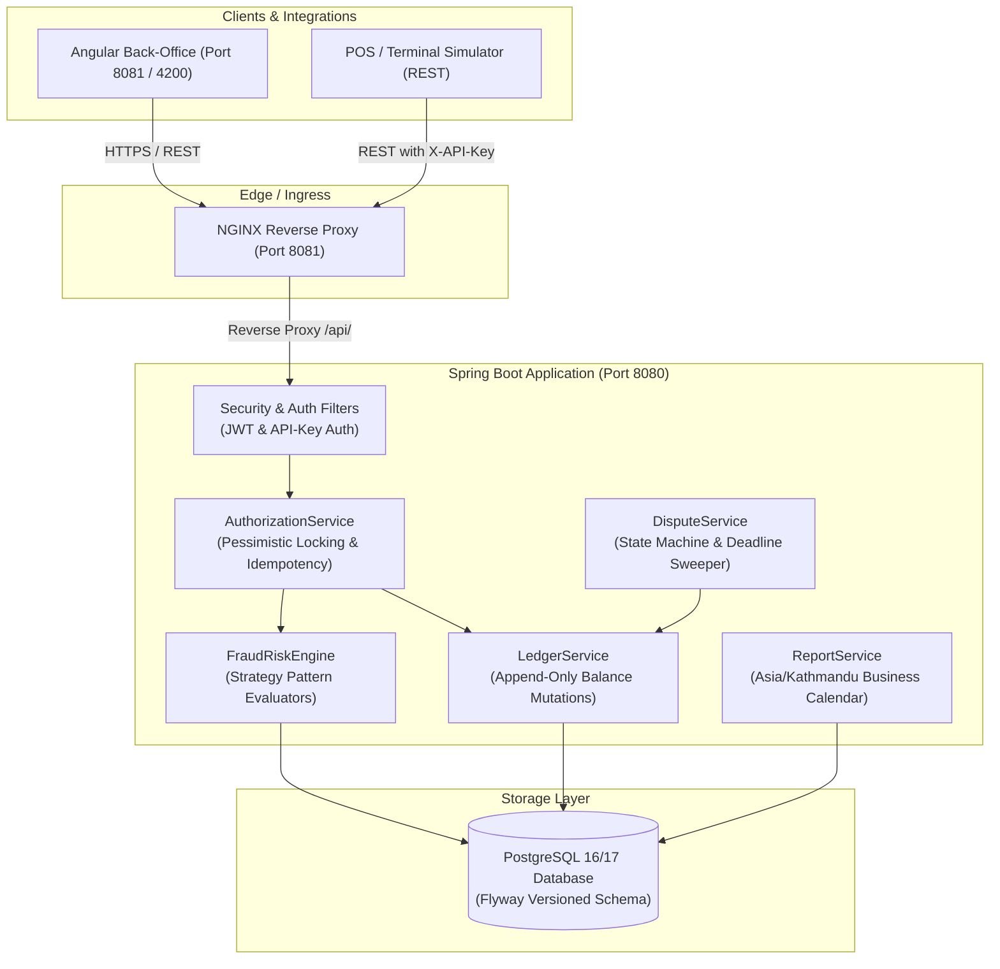

# ATM Card Processor

Production-style prepaid card issuer-processing engine and back-office management system built with Spring Boot, PostgreSQL, and Angular.

[](https://github.com/sunil-poudel/minicard-processor/actions/workflows/ci.yml)

---

## User Interface

### Back-Office Dashboard


### Card Issuance & Lifecycle Management


### Point-of-Sale Authorization Simulator


### Configurable Fraud Rules & Velocity Thresholds


### Transaction Disputes & Evidence Timeline


### Operational Reports (Asia/Kathmandu Business Zone)


---

## Features

- **Strict Money Safety**: All amounts represented exclusively as 64-bit integer (`long`) minor units. Zero floating-point rounding or balance drift.
- **Append-Only Immutable Ledger**: Balances are derived and audited via immutable double-entry ledger mutations; only `LedgerService` alters card balances under pessimistic row locking (`SELECT ... FOR UPDATE`).
- **Deterministic 7-Step Authorization Sequence**: Exact ISO 8583 response codes (00 Approved, 51 Insufficient Funds, 61 Exceeds Limit, 57 Blocked MCC, 12 Invalid Transaction, 59 Suspected Fraud).
- **Idempotency with SHA-256 Fingerprinting**: Scoped per endpoint/client key. Replayed requests return cached responses with the `Idempotent-Replayed: true` header without mutating balances.
- **Cardholder Data Security (PCI-DSS Baselines)**: AES-256-GCM encryption with `cardId` Additional Authenticated Data (AAD), HMAC-SHA256 blind indexing for fast lookup, and masked PANs (`990000******1234`). Plaintext PAN is revealed exactly once at issuance.
- **Extensible Fraud Rule Engine**: Strategy pattern evaluators (`MAX_AMOUNT`, `VELOCITY` with sliding time window, `BLOCKED_MCC`) evaluating cumulative risk scores (0–100) and automated flags/declines.
- **Dispute Lifecycle State Machine**: Full issuer dispute lifecycle (`OPEN` -> `EVIDENCE_REQUESTED` -> `UNDER_REVIEW` -> `RESOLVED_WON` / `RESOLVED_LOST`) with atomic ledger crediting upon win and concurrent background sweeper using `FOR UPDATE SKIP LOCKED`.
- **Role-Based Access Control**: Strict roles (`ADMIN`, `ANALYST`, `DISPUTE_OFFICER`, and machine `API_CLIENT`) secured by JWTs in memory, rotating refresh tokens in `HttpOnly` cookies with reuse detection, and SHA-256 hashed API client keys (`mck_` prefix).
- **Modern Angular Frontend**: Standalone components, signals for local/UI reactivity, OnPush change detection, strict TypeScript generated from OpenAPI schemas, WCAG 2.1 AA accessible, and responsive across desktop and tablet.

---

## Architecture



ATM Card Processor is designed as a modular monolith. Domain boundaries (`cards`, `ledger`, `transactions`, `fraud`, `disputes`, `identity`, `reports`) are strictly isolated and verified at build time with ArchUnit. All balance mutations and authorization evaluations execute within PostgreSQL ACID transactions, eliminating distributed dual-write inconsistency.

---

## Tech Stack

| Component | Technology | Version |
|-----------|------------|---------|
| Runtime | OpenJDK (Eclipse Temurin) | 21 |
| Framework | Spring Boot | 4.1.1 |
| Security | Spring Security, Nimbus JOSE+JWT, BCrypt | 4.1.1 / 10.x |
| Database | PostgreSQL | 16 / 17 |
| Migrations | Flyway | 11.x |
| Frontend | Angular, Angular Material, Angular CDK | 19.2+ |
| Reactive State | Angular Signals & RxJS | 19 / 7.8 |
| Code Generation | openapi-typescript | 7.13 |
| E2E Testing | Playwright, @axe-core/playwright | 1.64 / 4.13 |
| Containerization | Docker & Docker Compose | Compose v2 |

---

## Quick Start

### Prerequisites
- Docker and Docker Compose v2 (or JDK 21, Node.js 20+, and PostgreSQL 16/17 locally)
- Git

### Launch with Docker Compose
```bash
# 1. Clone repository
git clone https://github.com/sunil-poudel/minicard-processor.git
cd minicard-processor

# 2. Configure environment
cp deploy/.env.example deploy/.env

# Optional: Generate production-grade random keys
chmod +x scripts/gen-secrets.sh
./scripts/gen-secrets.sh deploy/.env

# 3. Build and launch container stack
docker compose -f deploy/docker-compose.yml --env-file deploy/.env up --build -d

# 4. Verify deployment health
./scripts/smoke-test.sh http://localhost:8080
```

### Access URLs & Default Credentials
- **Back-Office UI**: `http://localhost:8081`
- **Backend API & Actuator**: `http://localhost:8080`
- **Default Administrator**:
  - **Email**: `admin@minicard.local`
  - **Password**: Configured in `deploy/.env` (`AdminPassword123!` or generated value)

### Trying the Payment Simulator
1. Log in to the back-office at `http://localhost:8081` with the administrator credentials.
2. Navigate to **Cards** -> Click **Issue Card** (enter name e.g. `John Doe`, initial balance `1000.00`).
3. View the one-time revealed card number, acknowledge, and click **Activate** on the card details page.
4. Navigate to **Payment Simulator** -> Select the active card -> Click **Grocery 500 (MCC 5411)** preset.
5. Click **Send Authorization** -> Observe instant `APPROVED (Code 00)` response.
6. Click **Send Authorization** again with the same idempotency key -> Observe `Idempotent Replay Detected` banner without double-debiting.
7. Click **Rapid-fire x6** -> Observe velocity rules trigger and decline subsequent attempts with code 59.

---

## Local Development

### 1. Database Setup
```bash
# Start local PostgreSQL on port 5432 or 5433
createdb -U postgres minicard
```

### 2. Backend Service
```bash
# Run backend with dev profile
SPRING_DATASOURCE_URL=jdbc:postgresql://localhost:5432/minicard \
SPRING_DATASOURCE_USERNAME=postgres \
SPRING_DATASOURCE_PASSWORD=postgres \
./backend/mvnw -f backend spring-boot:run -Dspring-boot.run.profiles=dev
```

### 3. Frontend Development Server
```bash
cd frontend
npm install
npm start
# UI runs at http://localhost:4200 with proxy routing /api to http://localhost:8080
```

---

## Verification & Testing

The repository includes a comprehensive, multi-layer verification suite:

```bash
# 1. Backend verification (Unit, Integration, ArchUnit, JaCoCo, Spotless)
./backend/mvnw -f backend verify

# 2. Frontend verification (Linting, Formatting, Component/Unit Tests, Build)
cd frontend
npm run lint
npm run format:check
npm test -- --watch=false
npm run build
cd ..

# 3. End-to-end tests & Accessibility (Playwright + Axe)
cd frontend
npm run e2e
cd ..

# 4. Full one-step automated verification
./scripts/verify-all.sh
```

---

## API Overview & OpenAPI Contract

The complete REST API contract is frozen and documented in [`docs/openapi.json`](docs/openapi.json). When running the backend in development mode, interactive Swagger UI is available at:
`http://localhost:8080/swagger-ui/index.html`

### Primary Endpoints

| Method | Endpoint | Description | Auth Required |
|--------|----------|-------------|---------------|
| `POST` | `/api/v1/auth/login` | Staff authentication; returns short-lived JWT & refresh cookie | Anonymous |
| `POST` | `/api/v1/auth/refresh` | Silent refresh exchanging refresh cookie for fresh JWT | Cookie |
| `POST` | `/api/v1/auth/logout` | Revokes refresh token family and clears cookies | Cookie |
| `POST` | `/api/v1/authorize` | Core transaction authorization engine with idempotency check | API Client Key |
| `GET` | `/api/v1/cards` | Filter and paginate issued cards | Staff |
| `POST` | `/api/v1/cards` | Issue new card with limits and one-time revealed PAN | Admin |
| `POST` | `/api/v1/cards/{id}/topup` | Credit card balance via append-only ledger entry | Admin |
| `POST` | `/api/v1/cards/{id}/activate` | Transition card from `INACTIVE` to `ACTIVE` | Admin |
| `GET` | `/api/v1/transactions` | Search and paginate authorization history | Staff |
| `GET` | `/api/v1/transactions/export` | Stream CSV export with RFC 4180 quoting and formula injection defense | Staff (not Dispute Officer) |
| `POST` | `/api/v1/disputes` | File transaction dispute challenge | Admin / Dispute Officer |
| `POST` | `/api/v1/disputes/{id}/resolve` | Settle dispute as WON (credits ledger) or LOST | Admin / Dispute Officer |
| `GET` | `/api/v1/reports/daily` | Operational KPI metrics in `Asia/Kathmandu` zone | Admin / Analyst |
| `GET` | `/actuator/health` | Anonymous liveness and readiness probe | Anonymous |

---

## Configuration Catalog

| Environment Variable | Target Property | Production Required | Description / Default |
|----------------------|-----------------|:-------------------:|-----------------------|
| `POSTGRES_DB` | `spring.datasource.url` | Yes | Database name (`minicard`) |
| `POSTGRES_USER` | `spring.datasource.username` | Yes | Database user (`minicard`) |
| `POSTGRES_PASSWORD` | `spring.datasource.password` | Yes | Strong database password |
| `APP_SECURITY_JWT_SECRET` | `app.security.jwt.secret` | Yes | Base64-encoded 256-bit+ HMAC signing secret |
| `APP_SECURITY_COOKIE_SECURE` | `app.security.cookie-secure` | No | Set `false` for plain HTTP dev, `true` in prod |
| `APP_SECURITY_CORS_ALLOWED_ORIGINS` | `app.security.cors-allowed-origins` | No | Whitelisted CORS origins (e.g. `http://localhost:4200`) |
| `APP_CRYPTO_PAN_CURRENT_KEY_ID` | `app.crypto.pan.current-key-id` | Yes | Active key ID for PAN encryption (`k1`) |
| `APP_CRYPTO_PAN_KEYS_K1` | `app.crypto.pan.keys.k1` | Yes | Base64-encoded 256-bit AES key for encryption |
| `APP_CRYPTO_PAN_HASH_KEY` | `app.crypto.pan.hash-key` | Yes | Base64-encoded 256-bit HMAC key for blind index |
| `APP_BOOTSTRAP_ADMIN_EMAIL` | `app.bootstrap-admin.email` | Yes | First administrator email |
| `APP_BOOTSTRAP_ADMIN_PASSWORD` | `app.bootstrap-admin.password` | Yes | First administrator password (min 12 chars) |
| `APP_CARDS_BIN` | `app.cards.bin` | No | Issuer Bank Identification Number (`990000`) |
| `APP_CARDS_EXPOSE_PAN_ON_ISSUE`| `app.cards.expose-pan-on-issue` | No | Set `true` to return plaintext PAN on issue response |
| `APP_BUSINESS_ZONE` | `app.business-zone` | No | Operating business timezone (`Asia/Kathmandu`) |
| `APP_FRAUD_FLAG_THRESHOLD` | `app.fraud.flag-threshold` | No | Risk score to flag transactions (`50`) |
| `APP_FRAUD_DECLINE_THRESHOLD` | `app.fraud.decline-threshold` | No | Risk score to decline transactions (`80`) |
| `APP_DISPUTES_EVIDENCE_DAYS` | `app.disputes.evidence-days` | No | Default days allowed for dispute evidence (`14`) |
| `APP_DISPUTES_DEADLINE_JOB_CRON`| `app.disputes.deadline-job-cron`| No | Cron expression for overdue sweeper |

---

## Security Notes

1. **Zero Secret Retention**: Full PAN, CVV, passwords, and raw cryptographic keys are never written to disk, stored in plain text, or emitted in log statements.
2. **Authenticated Encryption**: PAN encryption utilizes AES-256-GCM authenticated encryption with the unique card UUID passed as Additional Authenticated Data (AAD), preventing ciphertext transplant attacks across card records.
3. **Password Security**: Passwords enforce a 12-character minimum policy with mixed character classes and are hashed using BCrypt (work factor 12).
4. **Token Security**: JWT access tokens are short-lived (15 minutes) and stored exclusively in browser memory (never `localStorage` or `sessionStorage`). Refresh tokens are stored in `HttpOnly`, `SameSite=Strict` cookies with family reuse detection.
5. **CSV Injection Defense**: All exported strings beginning with `=`, `+`, `-`, `@`, tab, or carriage return characters are prepended with a single quote (`'`) to neutralize spreadsheet formula execution vulnerabilities.

---

## Design Decisions (ADR Index)

All non-trivial architectural decisions are recorded as Architecture Decision Records in [`docs/adr/`](docs/adr/):

- [ADR 0001: PostgreSQL and Flyway from Day One](docs/adr/0001-postgres-flyway-from-start.md)
- [ADR 0002: Resolved Dependency Versions](docs/adr/0002-versions.md)
- [ADR 0003: Modular Monolith and ArchUnit Enforcement](docs/adr/0003-modular-monolith-archunit.md)
- [ADR 0004: Money Represented as Long Minor Units](docs/adr/0004-money-long-minor-units.md)
- [ADR 0005: Pessimistic Row Locking for Balance Mutations](docs/adr/0005-pessimistic-locking.md)
- [ADR 0006: SHA-256 Fingerprint Idempotency](docs/adr/0006-idempotency-key-scope-fingerprint.md)
- [ADR 0007: AES-256-GCM PAN Encryption and Blind Indexing](docs/adr/0007-pan-encryption-blind-index.md)
- [ADR 0008: JWT Access Tokens and Rotating Refresh Cookies](docs/adr/0008-jwt-cookie-refresh-rotation.md)
- [ADR 0009: API Keys with Prefixed SHA-256 Hashing](docs/adr/0009-api-key-prefix-and-hash.md)
- [ADR 0010: Append-Only Immutable Ledger](docs/adr/0010-immutable-ledger-service.md)
- [ADR 0011: Business-Zone Day Boundaries in Asia/Kathmandu](docs/adr/0011-business-zone-day-boundaries.md)
- [ADR 0012: No Lombok and Pure Java 21 Records for DTOs](docs/adr/0012-no-lombok-records-dtos.md)
- [ADR 0014: Dispute State Machine and Concurrency Sweeper](docs/adr/0014-dispute-state-machine-concurrency.md)
- [ADR 0015: RFC 9457 Problem Details for HTTP APIs](docs/adr/0015-problem-details-error-catalog.md)
- [ADR 0016: Dual Test Execution Support (Testcontainers & Native PostgreSQL Fallback)](docs/adr/0016-dual-test-support.md)

---

## Limitations

As defined in the project specification ([`docs/01-PRODUCT-AND-SCOPE.md`](docs/01-PRODUCT-AND-SCOPE.md)), this system contains intentional simplifications:

| Real-World Feature | ATM Card Processor Implementation | Rationale |
|--------------------|-----------------------------------|-----------|
| Dual-message clearing (Auth Hold -> Settle days later) | Single-message immediate settlement | Simplifies prepaid balance availability without dual-phase reconciliation |
| ISO 8583 / AS2805 binary messaging | JSON HTTP REST endpoints referencing UUID `cardId` | Clearer developer onboarding and contract predictability |
| CVV / PIN cryptographic verification in HSM | CVV/PIN omitted; never generated or stored | Avoids fake or insecure software PIN verification implementations |
| Complex global currencies and exponents | Currencies restricted to NPR and USD (both 2 decimal digits) | Eliminates rounding discrepancies without introducing complex floating-point types |
| Multi-round scheme arbitrations and partial disputes | Single full-amount dispute per transaction | Models core dispute state machine while keeping ledger mutations deterministic |
| Distributed cluster leader election | In-process `@Scheduled` job with PostgreSQL `FOR UPDATE SKIP LOCKED` | Safe for multi-instance deployments without requiring external ZooKeeper/Consul clusters |
| Hardware Security Module (HSM) custody | AES-256 keys supplied via environment configuration | Enables containerized CI/CD testing without physical HSM appliances |

---

## Project Structure

```
atm-card-processor/
├── .github/workflows/ci.yml       # GitHub Actions CI workflow
├── backend/                       # Spring Boot 4.1.1 Java 21 Application
│   ├── src/main/java/             # Package-by-feature domain modules
│   │   └── dev/minicard/processor/
│   │       ├── cards/             # Card lifecycle, limits, PAN generation
│   │       ├── common/            # Money, time calendar, UUIDv7, error handling
│   │       ├── crypto/            # AES-256-GCM cipher, HMAC blind indexer
│   │       ├── demo/              # Idempotent demo data seeder
│   │       ├── disputes/          # Dispute state machine & overdue sweeper
│   │       ├── fraud/             # Strategy pattern risk evaluators & engine
│   │       ├── identity/          # Staff users, API clients, JWT & password validation
│   │       ├── ledger/            # Immutable ledger entries & balance mutation port
│   │       ├── reports/           # Asia/Kathmandu analytics & CSV streaming
│   │       ├── security/          # Spring Security filters, CORS, entry points
│   │       └── transactions/      # 7-step authorization core & idempotency
│   └── src/main/resources/db/     # Flyway versioned schema migrations (V1..V6)
├── frontend/                      # Angular 19+ Back-Office Frontend
│   ├── e2e/                       # Playwright E2E and Axe accessibility suite
│   └── src/app/
│       ├── core/                  # API client, AuthStore, interceptors, guards
│       ├── features/              # Vertical slices (cards, simulator, disputes, etc.)
│       └── shared/                # UI components (money pipe, chips, copy button)
├── deploy/                        # Containerization & Deployment
│   ├── docker-compose.yml         # Postgres 17, backend, and frontend stack
│   ├── nginx.conf                 # Reverse proxy and SPA routing
│   └── .env.example               # Complete environment variable catalog
├── docs/                          # Architectural documentation, ADRs, openapi.json
└── scripts/                       # Operational scripts (gen-secrets, smoke-test, verify-all)
```

---

## Contributing & Commit Conventions

Commits strictly adhere to the [Conventional Commits](https://www.conventionalcommits.org/) specification:
- `feat(scope): ...` for new features
- `fix(scope): ...` for bug fixes
- `test(scope): ...` for test suites and assertions
- `docs(scope): ...` for architectural documentation and ADRs
- `refactor(scope): ...` for structural refactoring without behavior change
- `chore(scope): ...` for dependencies and configuration updates

---

## License

This project is licensed under the MIT License — see the [LICENSE](LICENSE) file for details.
