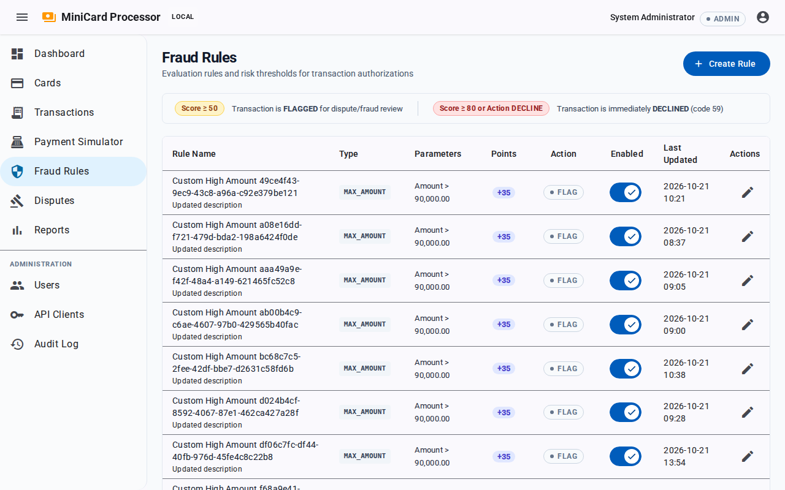
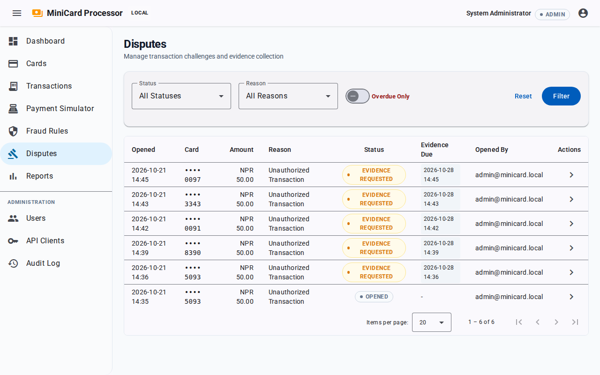

# ATM Card Processor

> A mission-critical prepaid card issuer processing platform and back-office management system built with Spring Boot, PostgreSQL, and Angular.

[](https://atm-card-processor.sunilpoudel01.com.np)

---

## 📸 Screenshots

| Back-Office Dashboard | Card Management & Issuance |
| :---: | :---: |
|  |  |

| POS Authorization Simulator | Fraud Rules & Velocity Thresholds |
| :---: | :---: |
|  |  |

| Disputes & Evidence Lifecycle | Daily Operational Reports |
| :---: | :---: |
|  |  |

---

## ⚡ Core Features

- **Strict Money Safety & Ledger**: 64-bit integer (`long`) minor units for all balances and amounts—zero floating-point drift. Append-only double-entry ledger with pessimistic row locking (`SELECT ... FOR UPDATE`).
- **Deterministic Authorization Engine**: 7-step ISO 8583 validation (`00 Approved`, `51 Insufficient Funds`, `61 Exceeds Limit`, `57 Blocked MCC`, `59 Suspected Fraud`).
- **SHA-256 Idempotency**: Per-endpoint client key scoping. Replayed requests return cached responses with `Idempotent-Replayed: true` without double-debiting.
- **Card Security & PCI-DSS Baselines**: AES-256-GCM encryption with AAD, HMAC-SHA256 blind indexing for fast lookup, and masked PANs (`990000******1234`).
- **Configurable Fraud Rules**: Strategy-pattern evaluators (`MAX_AMOUNT`, sliding-window `VELOCITY`, `BLOCKED_MCC`) computing real-time risk scores (0–100).
- **Dispute Lifecycle Engine**: Multi-state dispute tracking (`OPEN` → `EVIDENCE_REQUESTED` → `UNDER_REVIEW` → `RESOLVED_WON` / `RESOLVED_LOST`) with automated deadline sweeper (`FOR UPDATE SKIP LOCKED`).
- **Modern Back-Office UI**: Angular 19 standalone architecture, signals, clean light/dark modes, high-contrast fintech aesthetic, and full role-based access control (`ADMIN`, `ANALYST`, `DISPUTE_OFFICER`).

---

## 🛠️ Tech Stack

| Layer | Technologies |
|---|---|
| **Backend** | Java 21, Spring Boot 3, Spring Security (JWT + HttpOnly Cookies), Flyway |
| **Frontend** | Angular 19, Angular Material, Tailwind CSS, TypeScript |
| **Database** | PostgreSQL 17 |
| **DevOps** | Docker, Docker Compose, Nginx |

---

## 🚀 Quick Start (Docker)

### 1. Prerequisites
- Docker & Docker Compose v2

### 2. Run the Application
```bash
# Clone the repository
git clone <repository-url>
cd atm-card-processor

# Setup environment variables
cp deploy/.env.example deploy/.env

# Build and start services
docker compose -f deploy/docker-compose.yml --env-file deploy/.env up --build -d
```

### 3. Access Endpoints
- **Back-Office UI**: [http://localhost:8081](http://localhost:8081)
- **API & Health**: [http://localhost:8080/actuator/health](http://localhost:8080/actuator/health)
- **Default Admin Login**:
  - **Email**: `admin@minicard.local`
  - **Password**: Defined in `deploy/.env` (`AdminPassword123!`)

---

## 🧪 Testing

```bash
# Backend unit & integration tests
./backend/mvnw -f backend/pom.xml test

# Frontend unit tests
cd frontend && npm test -- --watch=false
```

---

## 📄 License

This project is licensed under the MIT License — see the [LICENSE](LICENSE) file for details.
