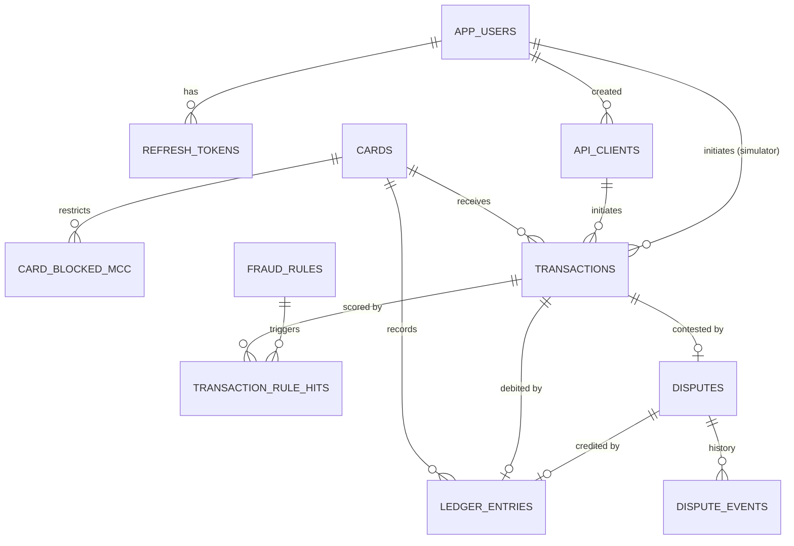
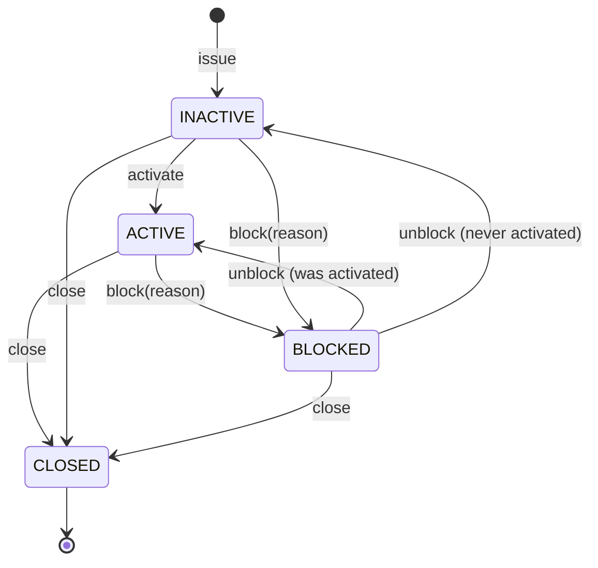
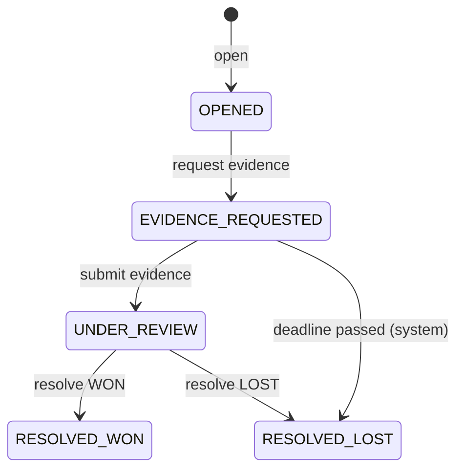

# 03. Domain Model and Database

This document is **normative** for the schema. Flyway migrations MUST create exactly this structure (you may add indexes that measurably help; you may not remove constraints).

## 1. Conventions

| Topic | Rule |
|-------|------|
| Primary keys | `UUID`, generated in the application (Hibernate `@UuidGenerator(style = TIME)` so ids are time-ordered). Never database sequences for business entities. |
| Timestamps | `TIMESTAMPTZ`, mapped to `java.time.Instant`. Set from the injected `Clock`. |
| Money | `BIGINT` minor units, mapped to `long`. Column suffix `_minor`. Never `NUMERIC` with decimals, never floating point. |
| Currency | 3-letter ISO code stored as `VARCHAR(3)`; allowed: `NPR`, `USD`. |
| Strings with fixed length | Use `VARCHAR(n)` plus a `CHECK` on length or pattern. **Do not use `CHAR(n)`** (Hibernate schema validation mismatches it with `String`). |
| Small integers | Use `INTEGER` mapped to `int`. **Do not use `SMALLINT`** (avoids Hibernate type mismatch). |
| Enums | `VARCHAR` with `CHECK (... IN (...))`, mapped with `@Enumerated(EnumType.STRING)`. Never ordinal. Never PostgreSQL native enum types. |
| Booleans | `BOOLEAN NOT NULL`, with defaults. |
| Optimistic locking | `version BIGINT NOT NULL DEFAULT 0` mapped with `@Version` on mutable aggregates. |
| Naming | `snake_case`; tables plural; constraints `pk_`, `fk_`, `ux_`, `ix_`, `ck_` prefixes. |
| Schema management | Flyway only. `spring.jpa.hibernate.ddl-auto=validate`. Migrations are immutable once committed; fix forward with a new version. |
| Soft delete | Not used. Entities that must not disappear are disabled or closed, never deleted. |
| Foreign keys | Always declared. `ON DELETE` is the default (no cascade) except where stated. |

## 2. Entity-relationship overview



## 3. Normative SQL (Flyway migrations)

File names: `backend/src/main/resources/db/migration/V<n>__<description>.sql`.

### V1__identity_and_audit.sql

```sql
CREATE TABLE app_users (
    id                    UUID         NOT NULL,
    email                 VARCHAR(254) NOT NULL,
    display_name          VARCHAR(100) NOT NULL,
    password_hash         VARCHAR(100) NOT NULL,
    role                  VARCHAR(20)  NOT NULL,
    enabled               BOOLEAN      NOT NULL DEFAULT TRUE,
    failed_login_attempts INTEGER      NOT NULL DEFAULT 0,
    locked_until          TIMESTAMPTZ  NULL,
    created_at            TIMESTAMPTZ  NOT NULL,
    updated_at            TIMESTAMPTZ  NOT NULL,
    version               BIGINT       NOT NULL DEFAULT 0,
    CONSTRAINT pk_app_users PRIMARY KEY (id),
    CONSTRAINT ck_app_users_role CHECK (role IN ('ADMIN', 'ANALYST', 'DISPUTE_OFFICER')),
    CONSTRAINT ck_app_users_failed CHECK (failed_login_attempts >= 0)
);
CREATE UNIQUE INDEX ux_app_users_email ON app_users (lower(email));

CREATE TABLE refresh_tokens (
    id             UUID         NOT NULL,
    user_id        UUID         NOT NULL,
    family_id      UUID         NOT NULL,
    token_hash     VARCHAR(64)  NOT NULL,
    issued_at      TIMESTAMPTZ  NOT NULL,
    expires_at     TIMESTAMPTZ  NOT NULL,
    revoked_at     TIMESTAMPTZ  NULL,
    replaced_by_id UUID         NULL,
    user_agent     VARCHAR(200) NULL,
    CONSTRAINT pk_refresh_tokens PRIMARY KEY (id),
    CONSTRAINT fk_refresh_tokens_user FOREIGN KEY (user_id) REFERENCES app_users (id),
    CONSTRAINT fk_refresh_tokens_replaced FOREIGN KEY (replaced_by_id) REFERENCES refresh_tokens (id),
    CONSTRAINT ux_refresh_tokens_hash UNIQUE (token_hash),
    CONSTRAINT ck_refresh_tokens_hash CHECK (char_length(token_hash) = 64)
);
CREATE INDEX ix_refresh_tokens_user ON refresh_tokens (user_id);
CREATE INDEX ix_refresh_tokens_family ON refresh_tokens (family_id);

CREATE TABLE api_clients (
    id           UUID         NOT NULL,
    name         VARCHAR(100) NOT NULL,
    key_prefix   VARCHAR(12)  NOT NULL,
    key_hash     VARCHAR(64)  NOT NULL,
    status       VARCHAR(10)  NOT NULL,
    created_by   UUID         NULL,
    created_at   TIMESTAMPTZ  NOT NULL,
    revoked_at   TIMESTAMPTZ  NULL,
    last_used_at TIMESTAMPTZ  NULL,
    version      BIGINT       NOT NULL DEFAULT 0,
    CONSTRAINT pk_api_clients PRIMARY KEY (id),
    CONSTRAINT fk_api_clients_created_by FOREIGN KEY (created_by) REFERENCES app_users (id),
    CONSTRAINT ux_api_clients_name UNIQUE (name),
    CONSTRAINT ux_api_clients_prefix UNIQUE (key_prefix),
    CONSTRAINT ck_api_clients_status CHECK (status IN ('ACTIVE', 'REVOKED')),
    CONSTRAINT ck_api_clients_hash CHECK (char_length(key_hash) = 64)
);

CREATE TABLE audit_events (
    id           UUID          NOT NULL,
    occurred_at  TIMESTAMPTZ   NOT NULL,
    actor_type   VARCHAR(12)   NOT NULL,
    actor_id     UUID          NULL,
    actor_label  VARCHAR(100)  NOT NULL,
    action       VARCHAR(60)   NOT NULL,
    entity_type  VARCHAR(40)   NULL,
    entity_id    UUID          NULL,
    request_id   VARCHAR(64)   NULL,
    ip_address   VARCHAR(45)   NULL,
    details      VARCHAR(1000) NULL,
    CONSTRAINT pk_audit_events PRIMARY KEY (id),
    CONSTRAINT ck_audit_events_actor_type CHECK (actor_type IN ('USER', 'API_CLIENT', 'SYSTEM', 'ANONYMOUS'))
);
CREATE INDEX ix_audit_events_time ON audit_events (occurred_at DESC);
CREATE INDEX ix_audit_events_entity ON audit_events (entity_type, entity_id);
CREATE INDEX ix_audit_events_action ON audit_events (action, occurred_at DESC);
```

### V2__cards_and_ledger.sql

```sql
CREATE TABLE cards (
    id                          UUID         NOT NULL,
    pan_encrypted               VARCHAR(300) NOT NULL,
    pan_key_id                  VARCHAR(20)  NOT NULL,
    pan_hash                    VARCHAR(64)  NOT NULL,
    bin                         VARCHAR(6)   NOT NULL,
    last4                       VARCHAR(4)   NOT NULL,
    holder_name                 VARCHAR(100) NOT NULL,
    expiry_month                INTEGER      NOT NULL,
    expiry_year                 INTEGER      NOT NULL,
    currency                    VARCHAR(3)   NOT NULL,
    status                      VARCHAR(10)  NOT NULL,
    balance_minor               BIGINT       NOT NULL DEFAULT 0,
    per_transaction_limit_minor BIGINT       NOT NULL,
    daily_limit_minor           BIGINT       NOT NULL,
    block_reason                VARCHAR(200) NULL,
    activated_at                TIMESTAMPTZ  NULL,
    blocked_at                  TIMESTAMPTZ  NULL,
    closed_at                   TIMESTAMPTZ  NULL,
    created_by                  UUID         NULL,
    created_at                  TIMESTAMPTZ  NOT NULL,
    updated_at                  TIMESTAMPTZ  NOT NULL,
    version                     BIGINT       NOT NULL DEFAULT 0,
    CONSTRAINT pk_cards PRIMARY KEY (id),
    CONSTRAINT fk_cards_created_by FOREIGN KEY (created_by) REFERENCES app_users (id),
    CONSTRAINT ux_cards_pan_hash UNIQUE (pan_hash),
    CONSTRAINT ck_cards_status CHECK (status IN ('INACTIVE', 'ACTIVE', 'BLOCKED', 'CLOSED')),
    CONSTRAINT ck_cards_currency CHECK (currency IN ('NPR', 'USD')),
    CONSTRAINT ck_cards_bin CHECK (bin ~ '^[0-9]{6}$'),
    CONSTRAINT ck_cards_last4 CHECK (last4 ~ '^[0-9]{4}$'),
    CONSTRAINT ck_cards_expiry_month CHECK (expiry_month BETWEEN 1 AND 12),
    CONSTRAINT ck_cards_expiry_year CHECK (expiry_year BETWEEN 2000 AND 2100),
    CONSTRAINT ck_cards_balance CHECK (balance_minor >= 0),
    CONSTRAINT ck_cards_per_txn_limit CHECK (per_transaction_limit_minor > 0),
    CONSTRAINT ck_cards_daily_limit CHECK (daily_limit_minor >= per_transaction_limit_minor)
);
CREATE INDEX ix_cards_status ON cards (status);
CREATE INDEX ix_cards_created_at ON cards (created_at DESC);
CREATE INDEX ix_cards_holder_lower ON cards (lower(holder_name));
CREATE INDEX ix_cards_last4 ON cards (last4);

CREATE TABLE card_blocked_mcc (
    card_id UUID       NOT NULL,
    mcc     VARCHAR(4) NOT NULL,
    CONSTRAINT pk_card_blocked_mcc PRIMARY KEY (card_id, mcc),
    CONSTRAINT fk_card_blocked_mcc_card FOREIGN KEY (card_id) REFERENCES cards (id),
    CONSTRAINT ck_card_blocked_mcc_mcc CHECK (mcc ~ '^[0-9]{4}$')
);

-- Created in V2 (not V3) because ledger rows reference disputes and transactions by id only
-- through nullable columns whose foreign keys are added in V5 once those tables exist.
CREATE TABLE ledger_entries (
    id                   UUID          NOT NULL,
    card_id              UUID          NOT NULL,
    entry_type           VARCHAR(20)   NOT NULL,
    amount_minor         BIGINT        NOT NULL,
    balance_after_minor  BIGINT        NOT NULL,
    transaction_id       UUID          NULL,
    dispute_id           UUID          NULL,
    description          VARCHAR(200)  NULL,
    created_by           VARCHAR(100)  NOT NULL,
    created_at           TIMESTAMPTZ   NOT NULL,
    CONSTRAINT pk_ledger_entries PRIMARY KEY (id),
    CONSTRAINT fk_ledger_entries_card FOREIGN KEY (card_id) REFERENCES cards (id),
    CONSTRAINT ck_ledger_entries_type CHECK (entry_type IN ('TOPUP', 'PURCHASE', 'DISPUTE_CREDIT')),
    CONSTRAINT ck_ledger_entries_amount CHECK (amount_minor <> 0),
    CONSTRAINT ck_ledger_entries_balance CHECK (balance_after_minor >= 0),
    CONSTRAINT ck_ledger_entries_sign CHECK (
        (entry_type = 'PURCHASE' AND amount_minor < 0) OR
        (entry_type IN ('TOPUP', 'DISPUTE_CREDIT') AND amount_minor > 0)),
    CONSTRAINT ck_ledger_entries_refs CHECK (
        (entry_type = 'PURCHASE' AND transaction_id IS NOT NULL AND dispute_id IS NULL) OR
        (entry_type = 'DISPUTE_CREDIT' AND dispute_id IS NOT NULL AND transaction_id IS NULL) OR
        (entry_type = 'TOPUP' AND transaction_id IS NULL AND dispute_id IS NULL))
);
CREATE INDEX ix_ledger_entries_card_time ON ledger_entries (card_id, created_at DESC);
CREATE UNIQUE INDEX ux_ledger_entries_transaction ON ledger_entries (transaction_id) WHERE transaction_id IS NOT NULL;
CREATE UNIQUE INDEX ux_ledger_entries_dispute ON ledger_entries (dispute_id) WHERE dispute_id IS NOT NULL;
```

### V3__transactions.sql

```sql
CREATE TABLE transactions (
    id                     UUID          NOT NULL,
    card_id                UUID          NOT NULL,
    api_client_id          UUID          NULL,
    initiated_by_user_id   UUID          NULL,
    idempotency_scope      VARCHAR(80)   NOT NULL,
    idempotency_key        VARCHAR(64)   NOT NULL,
    request_fingerprint    VARCHAR(64)   NOT NULL,
    amount_minor           BIGINT        NOT NULL,
    currency               VARCHAR(3)    NOT NULL,
    merchant_name          VARCHAR(100)  NOT NULL,
    mcc                    VARCHAR(4)    NOT NULL,
    reference              VARCHAR(64)   NULL,
    status                 VARCHAR(10)   NOT NULL,
    response_code          VARCHAR(2)    NOT NULL,
    decline_reason         VARCHAR(30)   NULL,
    flagged                BOOLEAN       NOT NULL DEFAULT FALSE,
    risk_score             INTEGER       NOT NULL DEFAULT 0,
    balance_after_minor    BIGINT        NULL,
    processing_millis      INTEGER       NOT NULL DEFAULT 0,
    created_at             TIMESTAMPTZ   NOT NULL,
    CONSTRAINT pk_transactions PRIMARY KEY (id),
    CONSTRAINT fk_transactions_card FOREIGN KEY (card_id) REFERENCES cards (id),
    CONSTRAINT fk_transactions_client FOREIGN KEY (api_client_id) REFERENCES api_clients (id),
    CONSTRAINT fk_transactions_user FOREIGN KEY (initiated_by_user_id) REFERENCES app_users (id),
    CONSTRAINT ux_transactions_idempotency UNIQUE (idempotency_scope, idempotency_key),
    CONSTRAINT ck_transactions_status CHECK (status IN ('APPROVED', 'DECLINED')),
    CONSTRAINT ck_transactions_amount CHECK (amount_minor > 0),
    CONSTRAINT ck_transactions_currency CHECK (currency IN ('NPR', 'USD')),
    CONSTRAINT ck_transactions_mcc CHECK (mcc ~ '^[0-9]{4}$'),
    CONSTRAINT ck_transactions_response_code CHECK (response_code ~ '^[0-9]{2}$'),
    CONSTRAINT ck_transactions_risk CHECK (risk_score BETWEEN 0 AND 100),
    CONSTRAINT ck_transactions_fingerprint CHECK (char_length(request_fingerprint) = 64),
    CONSTRAINT ck_transactions_initiator CHECK (
        (api_client_id IS NOT NULL AND initiated_by_user_id IS NULL) OR
        (api_client_id IS NULL AND initiated_by_user_id IS NOT NULL)),
    CONSTRAINT ck_transactions_consistency CHECK (
        (status = 'APPROVED' AND response_code = '00' AND decline_reason IS NULL AND balance_after_minor IS NOT NULL) OR
        (status = 'DECLINED' AND response_code <> '00' AND decline_reason IS NOT NULL AND balance_after_minor IS NULL AND flagged = FALSE))
);
CREATE INDEX ix_transactions_card_time ON transactions (card_id, created_at DESC);
CREATE INDEX ix_transactions_time ON transactions (created_at DESC);
CREATE INDEX ix_transactions_status_code_time ON transactions (status, response_code, created_at DESC);
CREATE INDEX ix_transactions_mcc ON transactions (mcc);
CREATE INDEX ix_transactions_flagged ON transactions (created_at DESC) WHERE flagged = TRUE;

ALTER TABLE ledger_entries
    ADD CONSTRAINT fk_ledger_entries_transaction FOREIGN KEY (transaction_id) REFERENCES transactions (id);
```

### V4__fraud_rules.sql

```sql
CREATE TABLE fraud_rules (
    id              UUID          NOT NULL,
    name            VARCHAR(100)  NOT NULL,
    description     VARCHAR(300)  NULL,
    rule_type       VARCHAR(20)   NOT NULL,
    enabled         BOOLEAN       NOT NULL DEFAULT TRUE,
    threshold_value BIGINT        NULL,
    window_seconds  INTEGER       NULL,
    mcc_codes       VARCHAR(300)  NULL,
    score_points    INTEGER       NOT NULL,
    action          VARCHAR(10)   NOT NULL,
    created_at      TIMESTAMPTZ   NOT NULL,
    updated_at      TIMESTAMPTZ   NOT NULL,
    version         BIGINT        NOT NULL DEFAULT 0,
    CONSTRAINT pk_fraud_rules PRIMARY KEY (id),
    CONSTRAINT ck_fraud_rules_type CHECK (rule_type IN ('MAX_AMOUNT', 'VELOCITY', 'BLOCKED_MCC')),
    CONSTRAINT ck_fraud_rules_action CHECK (action IN ('FLAG', 'DECLINE')),
    CONSTRAINT ck_fraud_rules_points CHECK (score_points BETWEEN 1 AND 100),
    -- NULL-safe on purpose: a CHECK that evaluates to NULL passes, so every nullable column is tested explicitly.
    CONSTRAINT ck_fraud_rules_params CHECK (
        (rule_type = 'MAX_AMOUNT'  AND threshold_value IS NOT NULL AND threshold_value > 0
                                   AND window_seconds IS NULL AND mcc_codes IS NULL) OR
        (rule_type = 'VELOCITY'    AND threshold_value IS NOT NULL AND threshold_value >= 1
                                   AND window_seconds IS NOT NULL AND window_seconds BETWEEN 1 AND 86400
                                   AND mcc_codes IS NULL) OR
        (rule_type = 'BLOCKED_MCC' AND threshold_value IS NULL AND window_seconds IS NULL
                                   AND mcc_codes IS NOT NULL AND char_length(mcc_codes) > 0))
);
CREATE UNIQUE INDEX ux_fraud_rules_name ON fraud_rules (lower(name));

CREATE TABLE transaction_rule_hits (
    id             UUID         NOT NULL,
    transaction_id UUID         NOT NULL,
    rule_id        UUID         NOT NULL,
    rule_name      VARCHAR(100) NOT NULL,
    rule_type      VARCHAR(20)  NOT NULL,
    points         INTEGER      NOT NULL,
    action         VARCHAR(10)  NOT NULL,
    detail         VARCHAR(200) NULL,
    CONSTRAINT pk_transaction_rule_hits PRIMARY KEY (id),
    CONSTRAINT fk_rule_hits_transaction FOREIGN KEY (transaction_id) REFERENCES transactions (id),
    CONSTRAINT fk_rule_hits_rule FOREIGN KEY (rule_id) REFERENCES fraud_rules (id)
);
CREATE INDEX ix_rule_hits_transaction ON transaction_rule_hits (transaction_id);
CREATE INDEX ix_rule_hits_rule ON transaction_rule_hits (rule_id);
```

### V5__disputes.sql

```sql
CREATE TABLE disputes (
    id               UUID          NOT NULL,
    transaction_id   UUID          NOT NULL,
    card_id          UUID          NOT NULL,
    reason           VARCHAR(30)   NOT NULL,
    description      VARCHAR(1000) NULL,
    status           VARCHAR(30)   NOT NULL,
    amount_minor     BIGINT        NOT NULL,
    currency         VARCHAR(3)    NOT NULL,
    opened_by        VARCHAR(100)  NOT NULL,
    opened_at        TIMESTAMPTZ   NOT NULL,
    evidence_due_at  TIMESTAMPTZ   NULL,
    resolved_at      TIMESTAMPTZ   NULL,
    resolved_by      VARCHAR(100)  NULL,
    resolution_note  VARCHAR(1000) NULL,
    version          BIGINT        NOT NULL DEFAULT 0,
    CONSTRAINT pk_disputes PRIMARY KEY (id),
    CONSTRAINT fk_disputes_transaction FOREIGN KEY (transaction_id) REFERENCES transactions (id),
    CONSTRAINT fk_disputes_card FOREIGN KEY (card_id) REFERENCES cards (id),
    CONSTRAINT ux_disputes_transaction UNIQUE (transaction_id),
    CONSTRAINT ck_disputes_status CHECK (status IN
        ('OPENED', 'EVIDENCE_REQUESTED', 'UNDER_REVIEW', 'RESOLVED_WON', 'RESOLVED_LOST')),
    CONSTRAINT ck_disputes_reason CHECK (reason IN
        ('UNAUTHORIZED_TRANSACTION', 'DUPLICATE_CHARGE', 'GOODS_NOT_RECEIVED', 'INCORRECT_AMOUNT', 'OTHER')),
    CONSTRAINT ck_disputes_amount CHECK (amount_minor > 0),
    CONSTRAINT ck_disputes_resolved CHECK (
        (status IN ('RESOLVED_WON', 'RESOLVED_LOST') AND resolved_at IS NOT NULL AND resolved_by IS NOT NULL) OR
        (status NOT IN ('RESOLVED_WON', 'RESOLVED_LOST') AND resolved_at IS NULL))
);
CREATE INDEX ix_disputes_status_due ON disputes (status, evidence_due_at);
CREATE INDEX ix_disputes_card ON disputes (card_id);

CREATE TABLE dispute_events (
    id          UUID          NOT NULL,
    dispute_id  UUID          NOT NULL,
    from_status VARCHAR(30)   NULL,
    to_status   VARCHAR(30)   NOT NULL,
    actor       VARCHAR(100)  NOT NULL,
    note        VARCHAR(1000) NULL,
    created_at  TIMESTAMPTZ   NOT NULL,
    CONSTRAINT pk_dispute_events PRIMARY KEY (id),
    CONSTRAINT fk_dispute_events_dispute FOREIGN KEY (dispute_id) REFERENCES disputes (id)
);
CREATE INDEX ix_dispute_events_dispute ON dispute_events (dispute_id, created_at);

ALTER TABLE ledger_entries
    ADD CONSTRAINT fk_ledger_entries_dispute FOREIGN KEY (dispute_id) REFERENCES disputes (id);
```

### V6__reference_data.sql (default fraud rules; fixed ids so tests can reference them)

```sql
INSERT INTO fraud_rules (id, name, description, rule_type, enabled, threshold_value, window_seconds, mcc_codes,
                         score_points, action, created_at, updated_at, version) VALUES
 ('00000000-0000-7000-8000-000000000001', 'High value payment',
  'Flags payments above 50,000.00 in minor units', 'MAX_AMOUNT', TRUE, 5000000, NULL, NULL, 40, 'FLAG', now(), now(), 0),
 ('00000000-0000-7000-8000-000000000002', 'Rapid-fire attempts',
  'Declines when 5 or more attempts already happened on the card in the last 60 seconds', 'VELOCITY', TRUE, 5, 60, NULL, 60, 'DECLINE', now(), now(), 0),
 ('00000000-0000-7000-8000-000000000003', 'Restricted merchant categories',
  'Declines betting merchants', 'BLOCKED_MCC', TRUE, NULL, NULL, '7995', 100, 'DECLINE', now(), now(), 0);
```

The agent may adjust the migration split (for example moving the cross-table foreign keys) provided the final schema is equivalent and `ddl-auto=validate` passes. Add a Flyway test that migrates an empty database and asserts the expected tables, unique constraints and check constraints exist.

## 4. JPA mapping guidance

| Entity | Notes |
|--------|-------|
| `AppUser` | `role` enum `UserRole { ADMIN, ANALYST, DISPUTE_OFFICER }`. Email normalized to lowercase before save and lookup. |
| `RefreshToken` | Never store the raw token. `tokenHash` = SHA-256 hex. |
| `ApiClient` | `ApiClientStatus { ACTIVE, REVOKED }`. |
| `Card` | `@ElementCollection` for blocked MCCs mapped to `card_blocked_mcc` (`Set<String>`), lazy. `balanceMinor` has **no public setter**; changed only through a package-private method called by `LedgerService`. |
| `LedgerEntry` | Immutable: no setters; protected constructor for JPA; static factory methods `topUp`, `purchase`, `disputeCredit`. `@Immutable` (Hibernate) to make updates impossible. |
| `Transaction` | Immutable after insert (`@Immutable`). Rule hits are separate `TransactionRuleHit` entities (`@Immutable`). |
| `FraudRule` | Validation of parameter combination in the domain constructor/updater, mirroring the `CHECK`. |
| `Dispute` | State changes only through `Dispute.transitionTo(next, actor, note, clock)` which enforces the state machine and appends a `DisputeEvent`. |
| `AuditEvent` | Immutable; `details` never contains secrets or full PAN. |

Equality: entities implement `equals`/`hashCode` on `id` only (class-aware, proxy-safe) or inherit from `BaseEntity`. No `toString` containing lazy collections or sensitive fields.

## 5. Enumerations

| Enum | Values |
|------|--------|
| `UserRole` | `ADMIN`, `ANALYST`, `DISPUTE_OFFICER` |
| `ApiClientStatus` | `ACTIVE`, `REVOKED` |
| `CardStatus` | `INACTIVE`, `ACTIVE`, `BLOCKED`, `CLOSED` (expiry is **derived** from `expiryMonth/expiryYear`, not a stored status) |
| `LedgerEntryType` | `TOPUP`, `PURCHASE`, `DISPUTE_CREDIT` |
| `TransactionStatus` | `APPROVED`, `DECLINED` |
| `DeclineReason` | `CARD_NOT_ACTIVE`, `CARD_EXPIRED`, `CURRENCY_MISMATCH`, `MCC_RESTRICTED`, `LIMIT_PER_TRANSACTION`, `LIMIT_DAILY`, `INSUFFICIENT_FUNDS`, `SUSPECTED_FRAUD` |
| `FraudRuleType` | `MAX_AMOUNT`, `VELOCITY`, `BLOCKED_MCC` |
| `FraudAction` | `FLAG`, `DECLINE` |
| `DisputeStatus` | `OPENED`, `EVIDENCE_REQUESTED`, `UNDER_REVIEW`, `RESOLVED_WON`, `RESOLVED_LOST` |
| `DisputeReason` | `UNAUTHORIZED_TRANSACTION`, `DUPLICATE_CHARGE`, `GOODS_NOT_RECEIVED`, `INCORRECT_AMOUNT`, `OTHER` |
| `ActorType` | `USER`, `API_CLIENT`, `SYSTEM`, `ANONYMOUS` |

Response codes and their mapping from `DeclineReason` are in `05`.

## 6. State machines

### 6.1 Card



Rules:
- `BLOCKED` then `unblock` always returns to **`ACTIVE`** if the card had been activated before (`activatedAt != null`), otherwise to `INACTIVE`. (Unblocking a never-activated card must not make it spendable.)
- `CLOSED` is terminal. A closed card **keeps** its balance record but cannot be topped up or used. Closing requires `balanceMinor == 0`, otherwise `INVALID_STATE_TRANSITION` with a clear message (`balance must be zero to close`).
- Any other transition is rejected with `INVALID_STATE_TRANSITION` (HTTP 409).
- Expiry is checked at authorization time; there is no `EXPIRED` stored status.

### 6.2 Dispute



`RESOLVED_WON` and `RESOLVED_LOST` are terminal. "Won / lost" is from the **cardholder's** point of view: won means the cardholder gets the money back. Every transition appends a `dispute_events` row.

### 6.3 Transaction

A transaction is **decided once** (`APPROVED` or `DECLINED`) and never changes afterward. There is no transaction state machine.

## 7. Money and currency rules

- `amountMinor` is a positive `long`. The API accepts `1 <= amountMinor <= 10_000_000_000` (that is 100,000,000.00 in major units). The same bounds apply to payments and top-ups; per-card limits are further constrained by the card's own limits.
- Arithmetic uses `Math.addExact` / `Math.subtractExact`; overflow produces `AMOUNT_OVERFLOW` (HTTP 422), never silent wraparound.
- Display conversion (`minor / 100`) happens only at the edges: CSV export and the Angular `money` pipe.
- Supported currencies: `NPR`, `USD`. Both have 2 minor-unit digits. A card has exactly one currency, fixed at issue.

## 8. Seed and bootstrap data

| Data | Source | When |
|------|--------|------|
| Default fraud rules | Flyway `V6` | Always |
| First admin user | `BootstrapAdminRunner` (reads `app.bootstrap.admin.*`) | At startup, only if **no user exists** and both email and password are configured |
| Demo data (cards, transactions) | Optional `DemoDataSeeder`, active only with profile `demo` | Used by README screenshots and e2e; never active in `prod` |

`DemoDataSeeder` creates about 8 cards in various states, a few top-ups and a handful of approved, declined and flagged transactions by calling the **real services** (not raw SQL), so every invariant holds.

## 9. Indexing and performance notes

- The authorization path queries: card by id (primary key, locked), transaction by `(scope, key)` (unique index), count of attempts for the card since a timestamp (`ix_transactions_card_time`), sum of ledger debits for the card since a timestamp (`ix_ledger_entries_card_time`). All are index-backed.
- List endpoints use keyset-friendly indexes; all list queries are paged with a hard maximum page size of 100.
- Reports use aggregate queries with the business-zone conversion done in SQL (`AT TIME ZONE`) on indexed time ranges; tests prove correctness at day boundaries.
